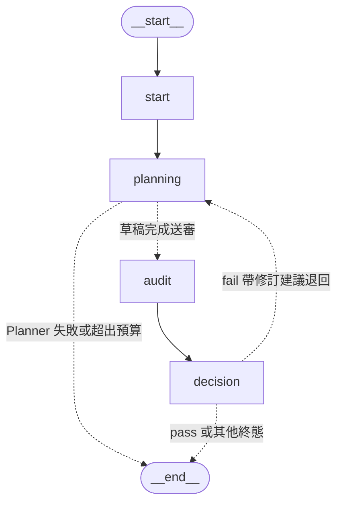
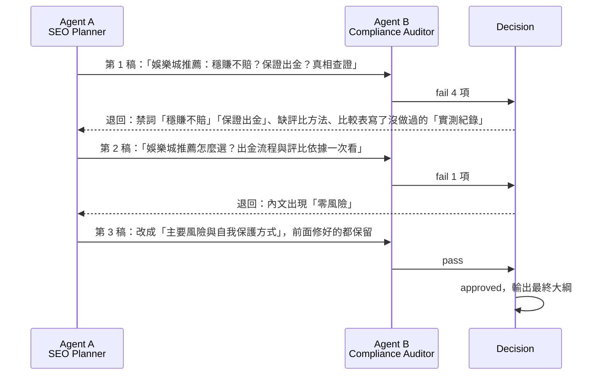

# 任務二：多代理人協作與衝突處理系統

用 **LangGraph** 讓兩個 AI Agent 一起規劃 SEO 文章大綱：一個追求點擊，一個把關合規。意見不合就退件重寫，直到雙方都能接受。

- **一個指令跑起來**：只需要網路，不用先裝 Python
- **真實模型實跑**：`claude-sonnet-5-5` 跑 3 次，3 次都協商成功（修正一次 prompt 後的結果，見 [3. 實跑結果](#實跑結果claude-sonnet-5-5跑-3-次)）
- **離線可驗證**：Task2 測試 61 個，不連模型

> **授權**：本專案僅授權面試評估使用，禁止商業使用、整合或散布，詳見 [LICENSE](LICENSE)。

**目錄**：[1. 快速開始](#1-快速開始)｜[2. 系統怎麼運作](#2-系統怎麼運作)｜[3. 符合題目要求](#3-符合題目要求)｜[4. 交付物](#4-交付物)｜[5. 容錯設計](#5-容錯設計)｜[6. 常見問題](#6-常見問題)｜[題目原文](#題目原文)

---

## 1. 快速開始

在專案根目錄執行：

| 作業系統 | 指令 |
|---|---|
| macOS／Linux | `./start_task2.sh` |
| Windows（PowerShell） | `powershell -ExecutionPolicy Bypass -File .\start_task2.ps1` |

過程中會問你：**要不要貼 Anthropic API key**。（電腦裡沒有 uv 的話，會先多問一次要不要安裝 uv。）

- **貼上 key**：用真實模型跑，約 1–2 分鐘。key 不會顯示在畫面上，也不會存檔
- **直接按 Enter**：改用離線示範，不連網、不花額度

第一次約 5 分鐘，多半在下載 Hermes；之後再跑，已完成的步驟會自動略過。

**跑完會看到**（離線示範）：

```text
==> [1/4] 下載鎖定版 Hermes（驗 sha256；已存在就略過）
  下載 Hermes：20 MB
  下載 Hermes：40 MB
  下載 Hermes：60 MB
{"status": "fetched", "repo": "NousResearch/hermes-agent", "tag": "v2026.9.24", ...}
==> [2/4] 依 uv.lock 建立 .venv（Python 3.12）
...
==> [3/4] 選擇模型
模式：離線示範（fixture 模型，不連網、不花額度）
==> [4/4] 執行 LangGraph 協商：Start → Planning → Audit → Decision
------------------------ 最終大綱 ------------------------
# 內容規劃與合規審查：娛樂城推薦
- 終態：**approved**（第 2 份草稿通過 demo-ymyl-2026.11-v3）
...
結果：approved｜草稿 2 份｜每輪退件 5 → 0
```

結果都在 `t2-output/`：

| 檔案 | 內容 |
|---|---|
| `graph.mmd` | 工作流拓撲圖（Mermaid） |
| `latest/state_log.jsonl` | 每個節點執行後的狀態變化 |
| `latest/result.json` | 完整 State：每一稿、每輪退件原因、雙方對話、用量 |
| `latest/final.md` | 最終大綱與協商摘要 |

<details>
<summary>腳本實際做了什麼、其他參數、手動安裝（點開）</summary>

**腳本依序做的事**

1. 沒有 [uv](https://docs.astral.sh/uv/) 就先詢問，再用官方腳本安裝到 `~/.local/bin`，不修改 shell 設定檔；非互動環境（例如 CI）不詢問、直接安裝
2. uv 自動下載 Python 3.12，不碰系統原有的 Python
3. 下載鎖定版 Hermes 並驗 sha256
4. 依 `uv.lock` 在專案內建立 `.venv`，每個套件版本都固定
5. 詢問 API key，跑一次協商，印出大綱與結果摘要

除了 uv 本身，其他東西都裝在專案資料夾內。

**其他參數**

```bash
./start_task2.sh --offline   # 不問 key，直接離線跑
./start_task2.sh --test      # 先跑 Task2 測試再協商
```

**手動安裝**（macOS／Linux；Windows 把 `.venv/bin` 換成 `.venv\Scripts`）

```bash
uv run --no-project --python 3.12 python tools/fetch_hermes.py   # 需要 Python 3.11.4 以上，交給 uv 準備
uv sync --python 3.12 --extra dev --extra anthropic --frozen
.venv/bin/seo-agent collaborate --mode fixture --out /tmp/seo-t2
.venv/bin/seo-agent collaborate --mode fixture --force-policy always --out /tmp/seo-t2-conflict  # 示範不可收斂
.venv/bin/seo-agent graph
.venv/bin/python -m pytest -q tests -k "(t2 or collab) and not c06"
SEO_MODEL_API_KEY=... .venv/bin/seo-agent collaborate --mode anthropic --model claude-sonnet-5-5 --out /tmp/seo-t2-live
```

</details>

---

## 2. 系統怎麼運作

**角色**

- **Agent A：SEO Content Planner**：寫大綱，目標是點擊率，偏好吸睛的標題
- **Agent B：YMYL Compliance Auditor**：審大綱，抓誇大、誤導、高風險字眼
- **Decision**：程式判斷。通過就輸出；不通過就把「哪裡錯、為什麼、建議怎麼改」帶回 Planner

就像編輯和法務來回改稿：法務不只說「不行」，還會說「改成這樣就可以」，編輯每次都看得到之前所有被退的理由。

**工作流拓撲**（依 LangGraph 匯出的 [`graph.mmd`](reports/live-sonnet/graph.mmd) 簡化，節點與邊相同）



**設計重點**

- **禁詞由程式判定**：LLM Auditor 負責給修改建議，但不能讓違規稿通過；就算模型判 pass，規則抓到禁詞仍會退件
- **退件歷史全部帶回**：Planner 每輪都收到之前所有退件，不會改好這裡又把上一輪的問題改回去
- **不會無限循環**：最多 4 份草稿、12 次模型呼叫；如果強制詞每輪都要保留，就判為「不可收斂」並停止，不會假裝通過
- **草稿當資料、不當指令**：送給 Auditor 的草稿會用標記包住，避免草稿內容被當成指令（prompt injection）

**程式在哪**（`src/seo_agent/content_review/`）

| 檔案 | 負責 |
|---|---|
| [`graph.py`](src/seo_agent/content_review/graph.py) | State Schema、四個節點、條件邊、迭代上限、模型呼叫容錯 |
| [`prompts.py`](src/seo_agent/content_review/prompts.py) | Planner、Auditor 的角色 prompt |
| [`rules.py`](src/seo_agent/content_review/rules.py) | 合規規則：禁詞、風險揭露、比較依據 |
| [`anthropic_model.py`](src/seo_agent/content_review/anthropic_model.py) | 真實模型連線 |
| [`agents.py`](src/seo_agent/content_review/agents.py) | 模型介面與離線示範用的 fixture 模型 |
| [`render.py`](src/seo_agent/content_review/render.py) | 產生最終大綱與協商摘要 |

---

## 3. 符合題目要求

### 交付物

| 題目要的 | 狀態 | 在哪裡看 |
|---|:---:|---|
| Graph Visualization：拓撲圖，標出節點與邊 | ✅ | [2. 工作流拓撲](#2-系統怎麼運作)、[`graph.mmd`](reports/live-sonnet/graph.mmd) |
| State Logs：A、B 協商與退回的完整過程 | ✅ | [4.1](#41-state-logs狀態日誌)、[`r1/result.json`](reports/live-sonnet/r1/result.json) |
| Source Code：State Schema 與最大迭代次數 | ✅ | [4.2](#42-source-code原始碼)、[`graph.py`](src/seo_agent/content_review/graph.py) |
| Final Output：最終大綱與協商摘要 | ✅ | [4.3](#43-final-output最終產出)、[`r1/final.md`](reports/live-sonnet/r1/final.md) |

### 評核標準

| 面向 | 題目問的 | 狀態 | 怎麼做到 | 證據 |
|---|---|:---:|---|---|
| Logic & Flow | 能精準判斷何時結束循環？ | ✅ | 7 種終態：通過、到草稿上限、不可收斂、呼叫用完、Planner 失敗、Auditor 失敗、未預期的內部錯誤；只有「通過」算成功 | [`test_c23_c24_t2_failures.py`](tests/test_c23_c24_t2_failures.py) |
| Logic & Flow | State 帶著脈絡，讓 Planner 知道為什麼被退？ | ✅ | 每輪退件累積在 `findings_history`，全部帶回 Planner；程式把本輪要回應的退件記在 `responding_to`，Planner 用 `change_log` 說明怎麼改 | 下方實際紀錄、`test_planner_sees_why_and_revises` |
| Reasoning Quality | 修正建議有建設性？ | ✅ | 每條退件都有規則、位置、原因、建議改法；建議本身也不能含禁詞 | [`test_t2_review_fixes.py`](tests/test_t2_review_fixes.py) |
| Reasoning Quality | 平衡 SEO 與合規，不是單方面妥協？ | ✅ | 主關鍵字留在標題最前，用「怎麼選」「一次看」吸引點擊；禁詞改成揭露勝率、說明出金流程 | `test_final_outline_balanced`、[`r1/final.md`](reports/live-sonnet/r1/final.md) |
| Technical Maturity | 非同步調用正確？ | ✅ | 節點全是 `async`；模型呼叫用 `asyncio.wait_for` 設逾時；同步 SDK 用 `asyncio.to_thread` | [`graph.py`](src/seo_agent/content_review/graph.py) `call_json` |
| Technical Maturity | 處理模型延遲與 API 錯誤？ | ✅ | 逾時、429／5xx 退避重試；4xx 不重試；壞 JSON 重試且不算新草稿 | [5. 容錯設計](#5-容錯設計) |

**實際紀錄：Planner 怎麼知道為什麼被退**（r1，節錄自 [`result.json`](reports/live-sonnet/r1/result.json) 的 `messages`）

第 1 稿被 Auditor 退件，其中一條：

```json
{
  "rule_id": "R1-no-guarantee",
  "location": "title、meta_description、sections[0].heading、sections[0].bullets[0]",
  "reason": "「穩賺不賠」屬於無依據保證或誇大字眼，YMYL 內容零容忍（含空白、標點或簡體寫法），共 4 處",
  "suggestion": "刪除「穩賺不賠」，誠實揭露勝率與風險（例如「了解賠率與輸贏機率」）"
}
```

第 2 稿：`responding_to` 由程式從上一輪退件填入；`change_log` 是 Planner 寫的修改說明（r1 中模型自行對應到規則 ID）

```json
{
  "responding_to": ["R1-no-guarantee@title、meta_description、sections[0].heading、sections[0].bullets[0]", "..."],
  "change_log": [
    "…",
    "原第一段標題與首條 bullet 改為「賠率與輸贏機率」並強調博弈含風險；對應 R1-no-guarantee 的 sections[0] 修正；保留對誇大話術的揭露式好奇點",
    "原第二段標題改為「出金流程與審核時間說明」；對應 R1-no-guarantee 的 sections[1] 修正；保留出金關注這個高搜尋意圖",
    "…"
  ]
}
```

### 實跑結果（`claude-sonnet-5-5`，跑 3 次）

| run | 結果 | 每輪被退條數 | 模型呼叫 | 耗時 |
|---|:---:|---|:---:|---|
| r1 | ✅ approved | 4 → 1 → 0 | 6 | 90 秒 |
| r2 | ✅ approved | 7 → 0 | 4 | 72 秒 |
| r3 | ✅ approved | 7 → 0 | 4 | 71 秒 |

- 憑證：Claude 訂閱 setup-token。一般 API key 的請求格式用離線測試驗證（`test_full_review_through_adapter_with_console_api_key`）；連線標頭與實際呼叫沒有用 API key 驗證過
- 這是第二次正式實跑。第一次（attempt1）是 2/3：prompt 沒寫清楚 `unresolvable_constraints` 能放什麼，r1 被誤判為不可收斂；修正 prompt 後重跑三次，得到上表結果。兩次的紀錄都保留在 [`live-sonnet/`](reports/live-sonnet/)

> **外部條件，非實作缺陷**：題目說 Auditor 要參考「公司內部手冊（任務二數據）」，但出題方沒有提供。目前用自訂的 demo 規則（`demo-ymyl-2026.11-v3`），結果只代表符合 demo 規則，不代表真實法律合規。拿到手冊後替換 `rules.py` 的規則即可。

---

## 4. 交付物

以下用 r1 當例子，它協商了 3 輪，是三次裡最多的。

### 4.1 State Logs（狀態日誌）

完整紀錄：[`r1/state_log.jsonl`](reports/live-sonnet/r1/state_log.jsonl)（每個節點的狀態變化）、[`r1/result.json`](reports/live-sonnet/r1/result.json)（雙方完整對話）



### 4.2 Source Code（原始碼）

程式在 [`graph.py`](src/seo_agent/content_review/graph.py)

**State Schema**

```python
class ReviewState(TypedDict, total=False):
    topic: str
    forced_terms: list[str]
    draft: dict | None
    drafts: Annotated[list[dict], operator.add]            # 每一稿都留著
    messages: Annotated[list[dict], operator.add]          # Agent 對話
    findings_history: Annotated[list[list[dict]], operator.add]  # 歷次退件原因
    iteration: int
    max_iterations: int
    status: str
    # 另有 force_policy、findings、unresolvable、rule_version、usage、stop_reason
```

**Maximum Iterations**

```python
# 1. 到達草稿上限就停，並標記沒通過
elif state["iteration"] >= state["max_iterations"]:
    status = "max_iterations_reached"

# 2. LangGraph 步數上限，設定出錯也不會無限跑
app.astream(state, config={"recursion_limit": 4 * max_iterations + 6})
```

### 4.3 Final Output（最終產出）

完整大綱：[`r1/final.md`](reports/live-sonnet/r1/final.md)

**最終標題**：娛樂城推薦怎麼選？出金流程與評比依據一次看

**大綱**：賠率與輸贏機率 → 評比方法與資料來源 → 出金流程與審核時間 → 6 項查核清單 → 平台比較表（只用公開可查證資料） → 風險提醒（含未成年不得參與） → FAQ

**協商重點**

- 「穩賺不賠」改成章節「了解賠率與輸贏機率」，誠實揭露勝率
- 「保證出金」改成章節「出金流程與審核時間說明」
- 比較表拿掉沒做過的「實測紀錄」，查不到的資料標「未公開」
- 題目沒指定地區，所以沒有寫死任何地區

---

## 5. 容錯設計

程式在 [`graph.py`](src/seo_agent/content_review/graph.py) 的 `call_json`

| 情況 | 處理 |
|---|---|
| 非同步 | 節點都是 `async`；模型呼叫用 `asyncio.wait_for` 包住，同步 SDK 用 `asyncio.to_thread` |
| 模型太慢（離線示範） | 每次呼叫 20 秒逾時，逾時重試 1 次 |
| 模型太慢（真實模型） | SDK 讀取逾時 170 秒。請求可能已送達時不重送、直接停在 `planner_failed`／`auditor_failed`；連線還沒建立就逾時，才重試 1 次。外層另有 400 秒保護網 |
| 429、5xx | 退避後重試 1 次 |
| 401、403、其他 4xx | 不重試，直接停在 `planner_failed`／`auditor_failed`（402 額度不足停在 `budget_exhausted`） |
| 回傳不是 JSON 或格式不對 | 當成解析錯誤重試；重試不算一份新草稿 |
| 不確定請求有沒有送達 | 不自動重送，避免重複扣額度 |
| Auditor 失敗 | 永遠不會被當成通過 |
| 呼叫次數 | 每次最多 12 次，用完停在 `budget_exhausted` |
| 不可收斂 | 強制詞每輪都要保留（`--force-policy always`）時，停在 `conflict_unresolvable` |

對應測試：[`test_c23_c24_t2_failures.py`](tests/test_c23_c24_t2_failures.py)（延遲、壞 JSON、API 錯誤、預算）、[`test_t2_review_fixes.py`](tests/test_t2_review_fixes.py)

---

## 6. 常見問題

**Windows 顯示「已停用指令碼執行」？**
Windows 預設不允許執行 `.ps1`。用快速開始表格裡的完整指令：`powershell -ExecutionPolicy Bypass -File .\start_task2.ps1`。這個設定只對這一次有效，不會改系統設定。

**API key 去哪拿？要用多少？**
到 [Anthropic Console](https://console.anthropic.com/settings/keys) 建立；也可以貼 Claude 訂閱的 setup-token（`claude setup-token` 產生），程式會自動判別。每次最多 12 次模型呼叫；實跑 3 次，每次用 4–6 次。

**這是 LangGraph 作業，為什麼要下載 Hermes？**
LangGraph 流程本身不依賴 Hermes。真實模型連線和任務一共用 Hermes 的 Anthropic adapter，兩個任務用同一套憑證處理。離線示範用不到 Hermes，但為了讓環境和 lockfile 一致，還是會一起安裝。

**下載 Hermes 失敗（HTTP 429）？**
GitHub 偶爾限流。腳本會自動換下載來源並重試；仍失敗的話，手動下載畫面上提示的網址，再執行 `uv run --no-project --python 3.12 python tools/fetch_hermes.py --from-file <檔案>`。

**不想讓腳本安裝 uv？**
被詢問時回答 `n` 即可取消，自行[安裝 uv](https://docs.astral.sh/uv/getting-started/installation/) 後重跑。

**怎麼清乾淨？**
刪掉專案資料夾即可；如果 uv 是腳本裝的，另外刪 `~/.local/bin/uv`、`~/.local/bin/uvx` 和 `~/.config/uv`。

---

<a id="題目原文"></a>

<details>
<summary><b>題目原文</b>（點開）</summary>

#### 1. 測驗背景（Background）

在真實的 SEO 業務中，內容團隊常面臨「流量」與「合規」的兩難。本題要求你開發一個自動化工作流，模擬兩個具備不同職責的 AI Agent 進行協作。系統不僅要產出結果，更要展示當意見分歧時，系統如何透過 **Recursive Refinement（遞迴優化）** 達成最終的一致。

#### 2. 測驗要求（Requirements）

##### A. 代理人角色定義（Agent Definitions）

| Agent | 角色 | 目標 |
|---|---|---|
| Agent A | **SEO Content Planner**（SEO 內容規劃師） | 最大化搜尋點擊率。偏好使用吸睛、具備高度競爭力的關鍵字與標題。 |
| Agent B | **YMYL Compliance Auditor**（YMYL 合規審計師） | 確保內容 100% 符合法律規範與公司內部手冊（參考任務二數據）。對誇大、誤導或高風險字眼零容忍。 |

##### B. 工作流設計（Workflow Design）

- 建立一個 **Stateful（具備狀態的）** 圖架構。
- 流程必須包含：`Start` → `Planning` → `Audit` → `Decision Node`（條件判定）。
- **Conditional Edge（條件分支）**：
  - 若 Audit **通過**：輸出最後結果。
  - 若 Audit **失敗**：帶回具體修訂建議，返回 Planning 節點重新產出。

##### C. 邊緣案例：強制衝突處理（Edge Case: Forced Conflict）

- **情境設定**：使用者要求規劃「娛樂城推薦」內容。
- **衝突觸發**：SEO Planner 被設定為必須包含「穩賺不賠」或「保證出金」等高點擊關鍵字；而 Compliance Auditor 的規則是嚴禁此類詞彙。
- **任務**：受試者必須展示其系統如何透過 Agent 間的對話，最終自動修正為一個「既能吸引點擊，又符合法規（例如改為：誠實揭露勝率、強調資安審查）」的折衷版本。

#### 3. 交付物（Deliverables）

| 交付物 | 內容 |
|---|---|
| **Graph Visualization**（工作流拓撲圖） | 產出 LangGraph 的圖形化呈現（如 Mermaid 流程圖），清晰標註節點與邊緣邏輯。 |
| **State Logs**（狀態日誌） | 提供一組對話紀錄，展示 Agent A 與 Agent B 針對衝突點進行「協商」與「退回修正」的完整過程。 |
| **Source Code**（原始碼） | 包含 State Schema（狀態架構）的定義，以及如何限制 Maximum Iterations（最大迭代次數）以防止死循環。 |
| **Final Output**（最終產出） | 展示經過多輪協商後產出的最終文章大綱，以及協商過程的重點摘要說明。 |

#### 4. 評核標準（Evaluation Criteria）

| 面向 | 評核重點 |
|---|---|
| **Logic & Flow**（邏輯與流程） | 系統是否能精準判斷何時該結束循環？State（狀態）物件是否能完整攜帶之前的對話脈絡，讓 Planner 知道「為什麼被退件」？ |
| **Reasoning Quality**（推理品質） | Agent B 給出的「修正建議」是否具備建設性，能引導 Agent A 朝正確方向修改？最終產出是否真的平衡了 SEO 與合規，而非單方面向其中一方妥協。 |
| **Technical Maturity**（技術成熟度） | 是否正確處理了 Asynchronous（非同步）調用。對於 LLM Latency（模型延遲）與 API Errors（介面錯誤）是否有基本的容錯設計。 |

</details>
